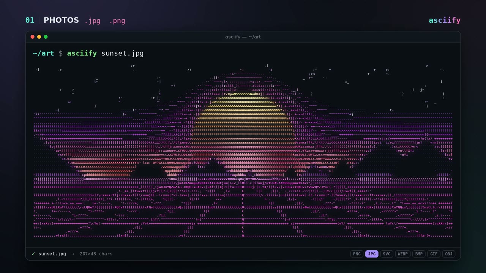

# asciify

Images and 3D models in the terminal. Photos become true-color ASCII art, and `.obj` / `.stl` models spin in a software rasterizer written from scratch in C++20. There is no GPU and no graphics library: the program writes characters and ANSI colors to a buffer.



## Features

- **Images:** jpg, png, bmp, gif, tga, psd, hdr and svg. webp, heic and avif are converted through ImageMagick when it is installed.
  - 24-bit color, or `-b` for half-block `▀` mode at double vertical resolution.
  - Full-screen view that re-renders when the terminal is resized.
- **3D models:** `.obj` (with colors from `.mtl`) and `.stl` (binary and text).
  - Own rasterizer: z-buffer, smooth normals with a 40° crease angle, Lambert shading and specular highlights.
  - Interactive: rotate with the mouse or arrow keys, zoom with the wheel, auto-tumble on two axes.
  - `--once` renders a single frame, for screenshots and scripts.
- **No file?** You get a spinning donut (`--cube` gives a cube).
- Clean exit on `q`, `Esc` or `Ctrl+C`: the terminal is always restored (raw mode, alt screen, mouse).

## Build

Requires CMake 3.20+ and a C++20 compiler. Linux / macOS terminal with true-color support.

```sh
cmake -S . -B build -DCMAKE_BUILD_TYPE=Release
cmake --build build -j
./build/ascii3d examples/rocket.obj
```

## Usage

```sh
ascii3d photo.jpg              # image, full screen
ascii3d -b photo.jpg           # half-block mode
ascii3d -p -w 80 photo.jpg     # just print it, 80 columns wide
ascii3d model.stl              # interactive 3D viewer
ascii3d model.obj --once -w 60 -H 20   # one frame as text
```

| Option | Meaning |
|---|---|
| `-w N` | width in columns |
| `-H N` | height in rows (3D with `--once`) |
| `-b` | half blocks `▀` instead of characters |
| `-p` | print the image instead of opening full screen |
| `--mono` | no color |
| `--invert` | for light terminal backgrounds |
| `--white` | transparent pixels become white |
| `--once` | 3D: render one frame and exit |
| `--cube`, `--donut` | demo models |

## How it works

```
src/
├── main.cpp        argument parsing, choose a viewer by file extension
├── image.*         image loading (stb_image, nanosvg) and ASCII / half-block rendering
├── imageview.cpp   full-screen image viewer
├── mesh.*          OBJ / STL loading, normalisation, smooth normals
├── viewer3d.*      rasterizer and interactive loop
├── term.*          terminal size, raw mode, restore on exit
├── fontzoom.*      Ctrl+wheel changes the Alacritty font size over IPC
└── vec.h           Vec3 / Mat3
```

Each frame, the rasterizer projects the triangles and fills them with a per-character depth test (`1/z`). It shades each fragment from the normal and the light direction, then maps the brightness to a character ramp `.,-~:;=!*#$@` and the color to a 24-bit ANSI escape.

## Third-party

[stb_image](https://github.com/nothings/stb) and [nanosvg](https://github.com/memononen/nanosvg), both in `third_party/`.
